<div align="center">



# Contributing to OPTIVEX

<sub>Thank you for helping make OPTIVEX better. Every contribution, from a typo fix to a new feature, is appreciated.</sub>

<br>

<a href="#welcome">Welcome</a> &nbsp;·&nbsp;
<a href="#ways-to-contribute">Ways to contribute</a> &nbsp;·&nbsp;
<a href="#development-environment">Setup</a> &nbsp;·&nbsp;
<a href="#coding-standards">Standards</a> &nbsp;·&nbsp;
<a href="#pull-request-process">Pull requests</a> &nbsp;·&nbsp;
<a href="#security-and-responsible-disclosure">Security</a>

</div>


## Welcome

OPTIVEX is a Windows PC optimization and monitoring application. You do not need to be an expert to contribute: clear bug reports, documentation fixes and tests are just as valuable as code. If this is your first open-source contribution, the [step-by-step workflow](#your-first-contribution-step-by-step) below is written for you.

By taking part you agree to be respectful and constructive. Be patient with questions, assume good intent, critique code and ideas rather than people, and welcome newcomers.

## Contribution philosophy

OPTIVEX is built on a few principles. Changes that respect them are easy to accept; changes that do not will be asked to change.

1. **Safety first.** OPTIVEX must never damage a user's files or system. When in doubt, do less and ask.
2. **Transparency.** If a value cannot be measured, show *Unavailable* and the reason. Never fabricate readings, game requirements, benchmark results or performance promises.
3. **User control.** Anything destructive needs a clear preview and explicit confirmation. Prefer reversible actions. Recommendations are advice and are never applied automatically.
4. **Privacy.** Data stays on the user's PC. Do not add telemetry, accounts or network calls.
5. **Maintainability.** Small, readable, tested changes that follow the existing structure.

## Ways to contribute

| You can... | Examples |
|---|---|
| **Report bugs** | Crashes, wrong readings, layout problems, confusing wording |
| **Suggest features** | New diagnostics, better explanations, accessibility ideas |
| **Improve documentation** | README fixes, clearer instructions, translations of docs |
| **Add or improve tests** | Edge cases, safety checks, regression tests |
| **Fix issues** | Anything labelled as a bug or enhancement |
| **Test on your hardware** | Report how OPTIVEX behaves on your laptop, GPU or battery, including what *Unavailable* readings you get |
| **Contribute game data** | Requirements for the game catalog, but only from the official publisher or store page (see [Documentation and data contributions](#documentation-and-data-contributions)) |

## Bug reporting

Search the [existing issues](https://github.com/rheillunio2-byte/OPTIVEX/issues) first, then open a new one with:

- **What happened** and **what you expected**
- **Steps to reproduce**, as precisely as you can
- Your **Windows version** (Settings > System > About) and whether it is a **laptop or desktop**
- The OPTIVEX **version** (shown in the app footer) and how you built or ran it
- **Screenshots** if it is a visual problem
- **Log excerpts** from `%LOCALAPPDATA%\OPTIVEX\logs`, **sanitized**: remove your user name, computer name and anything private

> [!WARNING]
> Never attach personal files or unredacted logs. For security problems, do **not** open a public issue. Follow [Security and responsible disclosure](#security-and-responsible-disclosure).

## Feature requests

Open an issue that describes:

- **The problem** you are trying to solve (not only the solution)
- **Who benefits** and how often
- **How it fits OPTIVEX's principles**: is it safe, transparent and under the user's control?
- **Alternatives** you considered
- Whether you would like to **implement it yourself**

For larger features, please discuss before writing code so effort is not wasted.

## Before contributing

- Check open issues and pull requests so you do not duplicate work.
- For anything bigger than a small fix, open or comment on an issue first.
- Read the [safety rules](#safety-rules-for-every-change) below. They apply to every pull request.
- Keep each pull request **small and focused** on one thing.

## Development environment

**Requirements**

- Windows 10 or 11 to run the app (the UI is WPF)
- The [.NET 8 SDK](https://dotnet.microsoft.com/download/dotnet/8.0). Check with `dotnet --version`.
- Git
- Optional: Visual Studio 2022 with the *.NET desktop development* workload

The core logic and tests target plain `net8.0`, so they also build and test on other operating systems. The WPF app and the Windows-specific infrastructure project need Windows.

**Set up**

```powershell
git clone https://github.com/<your-username>/OPTIVEX.git
cd OPTIVEX
dotnet restore OPTIVEX.sln
dotnet build OPTIVEX.sln -c Release
dotnet test tests/OPTIVEX.Tests/OPTIVEX.Tests.csproj
dotnet run --project src/OPTIVEX.App/OPTIVEX.App.csproj -c Release
```

In Visual Studio, open `OPTIVEX.sln`, set **OPTIVEX.App** as the startup project and press **F5**.

## Repository structure

```text
OPTIVEX/
├── OPTIVEX.sln
├── Directory.Build.props            shared version and copyright
├── LICENSE
├── README.md
├── CONTRIBUTING.md
├── images/                          screenshots and README artwork (SVG)
├── src/
│   ├── OPTIVEX.Core/                models, interfaces and decision logic (net8.0)
│   ├── OPTIVEX.Data/                SQLite history and settings storage (net8.0)
│   ├── OPTIVEX.Infrastructure/      WMI, sensors, file system, battery (net8.0-windows)
│   └── OPTIVEX.App/                 WPF views, theme, view models, composition root (net8.0-windows)
└── tests/
    └── OPTIVEX.Tests/               xUnit tests for Core and Data
```

**Where code belongs**

| Project | Put here | Never put here |
|---|---|---|
| `OPTIVEX.Core` | Models, interfaces, and rules about *what is safe* and *what to recommend* | Windows APIs, file scanning, UI, logging |
| `OPTIVEX.Data` | SQLite and JSON persistence | UI, Windows-only APIs |
| `OPTIVEX.Infrastructure` | WMI, sensors, registry, file-system access, battery | UI, business rules |
| `OPTIVEX.App` | Views, view models, dependency-injection wiring, theme | Decision logic (put it in Core and test it) |

A good rule of thumb: if it decides whether something is safe, or what to recommend, it belongs in `OPTIVEX.Core` with unit tests.

## Your first contribution, step by step

1. **Fork** the repository on GitHub (the *Fork* button).
2. **Clone** your fork and add the original as `upstream`:
   ```powershell
   git clone https://github.com/<your-username>/OPTIVEX.git
   cd OPTIVEX
   git remote add upstream https://github.com/rheillunio2-byte/OPTIVEX.git
   ```
3. **Create a branch** from an up-to-date `main`:
   ```powershell
   git fetch upstream
   git checkout -b fix/short-description upstream/main
   ```
4. **Make your change**, build and test it (see [Testing requirements](#testing-requirements)).
5. **Commit** with a clear message (see [Commit messages](#commit-messages)).
6. **Push** the branch to your fork and **open a pull request** against `main`.
7. Respond to review comments. Pushing more commits to the same branch updates the pull request.

## Branch naming

Use a short prefix and a lowercase, hyphenated description:

| Prefix | Use for | Example |
|---|---|---|
| `feature/` | New functionality | `feature/battery-report-export` |
| `fix/` | Bug fixes | `fix/startup-entry-publisher-crash` |
| `documentation/` | Documentation only | `documentation/clarify-install-steps` |
| `refactor/` | Code changes with no behaviour change | `refactor/split-recommendation-rules` |
| `test/` | Adding or fixing tests | `test/path-guard-edge-cases` |
| `chore/` | Tooling, dependencies, housekeeping | `chore/update-sqlite-package` |

## Commit messages

The recommended style is [Conventional Commits](https://www.conventionalcommits.org/):

```text
type(scope): short summary in the imperative mood

Optional body explaining what changed and why (not how).
```

- **Types:** `feat`, `fix`, `docs`, `style`, `refactor`, `perf`, `test`, `build`, `chore`
- **Scopes:** `core`, `data`, `infra`, `app`, `tests`, `docs`, `images`
- Keep the summary around 72 characters, in the imperative mood ("add", not "added")
- One logical change per commit

Examples:

```text
fix(core): refuse paths that only share a prefix with an approved root
feat(app): add keyboard shortcut for the Reports page
docs: explain how to publish a self-contained build
test(core): cover the integrated-graphics RAM requirement
```

## Coding standards

**General**

- Write clear, readable code. Prefer simple over clever.
- Comment the *why* (a non-obvious decision or constraint), not the *what*.
- Keep methods and classes focused. Follow the layering in [Repository structure](#repository-structure).
- Nullable reference types are enabled. Do not suppress warnings without a reason.
- Use `async` for scans and other long-running work. **Never block the UI thread.**
- Handle missing sensors, denied permissions and unsupported hardware gracefully. Represent "could not be read" as `null` or an *unavailable* reading with a reason, and show that reason.
- Log through Serilog. Do not swallow exceptions silently.

**C# and WPF**

- Follow the existing MVVM pattern (`CommunityToolkit.Mvvm`): view models do not reference views, and views contain no decision logic.
- Dependencies are injected. Register new services in `App.xaml.cs`.
- WPF projects do not import `System.IO` implicitly. Add `using System.IO;` where you use file types.
- Use the shared styles and brushes in `src/OPTIVEX.App/Views/Theme.xaml` (for example `Card`, `Caption`, `SecondaryButton`, `MutedBrush`) rather than hard-coding colours. Add new colours to the theme first.
- Use `ctl:AdaptivePanel` for rows of cards instead of fixed-column grids so layouts stay responsive.
- Give icon-only or custom controls an `AutomationProperties.Name`, and make sure everything is reachable with the keyboard.

**Dependencies**

- Avoid new dependencies. If one is genuinely needed, explain why in the pull request, check its licence is compatible with MIT, and keep it small and maintained.

## Safety rules for every change

These are non-negotiable. A pull request that breaks one will not be merged.

- **No destructive action without a preview and explicit confirmation.** The default button in a confirmation dialog must be the safe one.
- **Never delete personal files.** Do not widen the cleanup allow-list (`SafeStorageScanner.GetApprovedRoots`) without a safety review and tests for the new path.
- **Re-validate at the point of deletion.** Destructive code must check paths itself, not trust the UI's list.
- **No process termination, no Windows service changes, no registry cleaning, nothing that touches antivirus or Windows Defender.**
- **Prefer reversible changes.** The existing startup toggle is the model: it changes a per-user setting and deletes nothing.
- **No unsupported claims.** Do not add speed-up promises, FPS predictions or invented numbers.
- **No telemetry or network calls** without explicit, informed user consent and prior discussion.
- **Do not run destructive code against real personal data while testing.** Use throw-away files and folders.

## Pull request process

1. Make sure your branch is up to date with `main` and builds without errors.
2. Run the tests and complete the checklist below.
3. Open the pull request against `main` with a clear title (the same style as a commit message).
4. Describe **what** changed, **why**, how you **tested** it, and anything you **could not test** (for example hardware you do not own).
5. Include **screenshots** for UI changes, ideally at a normal and a narrow window width.
6. Respond to review feedback politely. Maintainers may ask for changes or for a large pull request to be split.

**Pull request checklist**

```markdown
- [ ] The change is small and focused on one thing
- [ ] It builds: `dotnet build OPTIVEX.sln -c Release`
- [ ] Tests pass: `dotnet test tests/OPTIVEX.Tests/OPTIVEX.Tests.csproj`
- [ ] I added or updated tests for new logic and for any safety-related change
- [ ] Anything destructive shows a preview and asks for confirmation
- [ ] Unavailable data is labelled as unavailable, not guessed
- [ ] No new dependency, or I explained why one is needed
- [ ] No telemetry, network calls or secrets
- [ ] I updated documentation if behaviour changed
- [ ] I noted anything I could not test
```

## Testing requirements

OPTIVEX uses [xUnit](https://xunit.net/). Run everything with:

```powershell
dotnet test tests/OPTIVEX.Tests/OPTIVEX.Tests.csproj
```

- **New logic needs tests**, especially anything in `OPTIVEX.Core` and `OPTIVEX.Data`.
- **Safety-related changes need tests for the edge cases**: path boundaries, `..` traversal, drive roots, symbolic links, unavailable data, and invalid input.
- **Fix a bug? Add a test that fails without your fix.**
- Tests must not touch real user folders. Use a temporary directory and clean it up.
- The suite runs on plain `net8.0`. It cannot verify WPF views or Windows-specific code (WMI, sensors, the registry, batteries). For those, **test manually on Windows** and describe what you did in the pull request: which page, which steps, what you saw, and on what kind of machine.
- For UI changes, look at the page on a real screen at a normal and a narrow window width, and with keyboard navigation (Tab, Enter, Esc, Ctrl+1 to Ctrl+9).
- **Be honest about what you tested.** "I could not test on a laptop with a battery" is a useful thing to write.

## Security and responsible disclosure

OPTIVEX works close to the file system and system settings, so security reports are taken seriously. Examples worth reporting include a way to make the cleaner delete outside its allow-list (path traversal or link handling), unintended privilege use, data exposure, or injection through system-provided text into the database or exported files.

- **Do not** open a public issue with exploit details.
- Use GitHub's private reporting: open the repository's **Security** tab and choose **Report a vulnerability**, if it is available.
- If you do not see that option, open a public issue titled *Security contact request* that contains **no technical details**, and a maintainer will arrange a private channel.
- Include what you found, steps to reproduce, the affected version, and the potential impact.
- Please give the maintainers a reasonable amount of time to respond and fix the problem before any public disclosure.

## Documentation and data contributions

**Docs**

- Write clearly and concisely, in plain language. Short paragraphs and descriptive headings help.
- Do not describe features that do not exist or claim results nobody measured. Mark anything you could not verify.
- Use relative links for files in the repository, and check them.

**Images and SVG artwork**

- Screenshots and SVG artwork live in `images/`. Reference them with relative paths such as `images/Overview.PNG`. Spaces in file names are written as `%20` in Markdown and HTML (for example `images/Storage%20Cleaner.PNG`).
- Please do not rename or move existing images in a pull request that changes something else. If a file needs renaming, do it in its own pull request and update every reference.
- SVG files must be standalone: no scripts, no external images or fonts, a proper `viewBox`, and a sensible static appearance. Animations should be subtle, and should respect `prefers-reduced-motion`.
- Do not include personal information in screenshots (user names, computer names, file paths you would not want public).

**Game catalog data**

- Add requirements only from the **official publisher or store page**, and include the source URL and the date you checked it. Third-party articles often disagree with the official figures.
- If the source does not publish a value, leave it blank rather than estimating.

## License

OPTIVEX is released under the **[MIT License](https://github.com/rheillunio2-byte/OPTIVEX?tab=MIT-1-ov-file)**. By submitting a contribution you agree that it is licensed under the same terms.


<div align="center">


<sub>Questions? Open an <a href="https://github.com/rheillunio2-byte/OPTIVEX/issues">issue</a>. Back to the <a href="README.md">README</a>.</sub>

</div>
