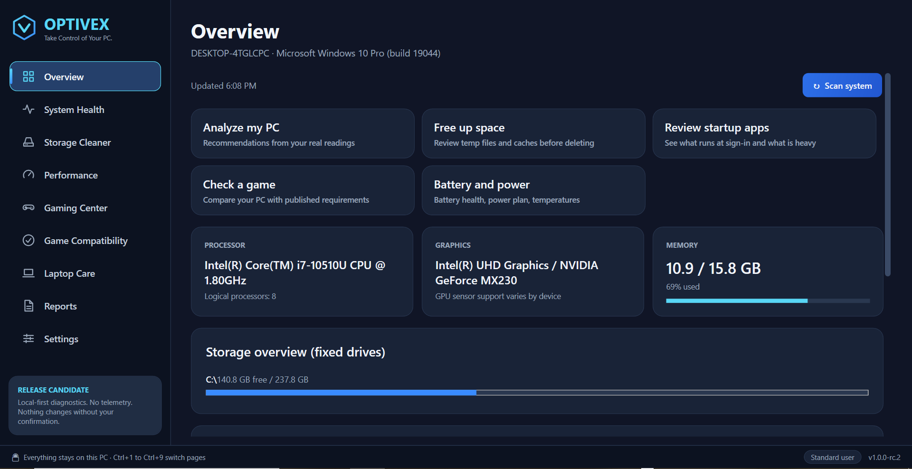
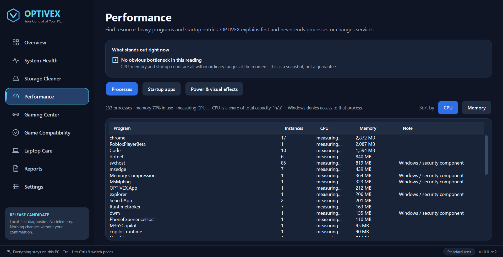
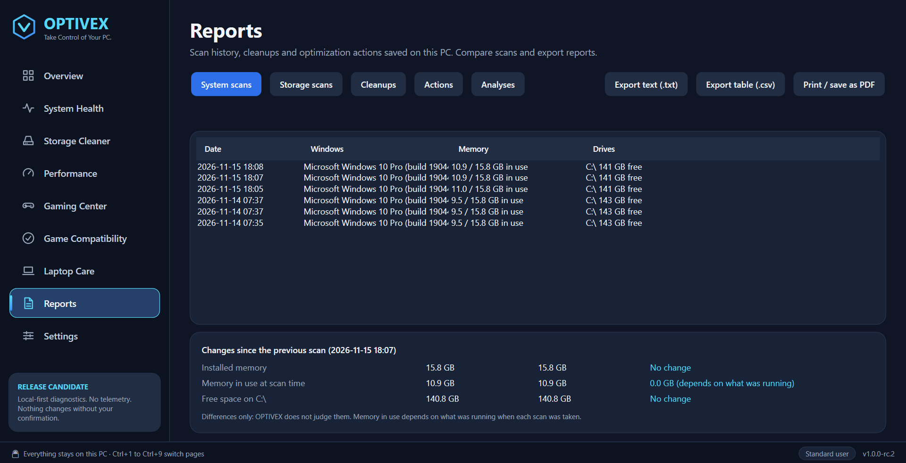
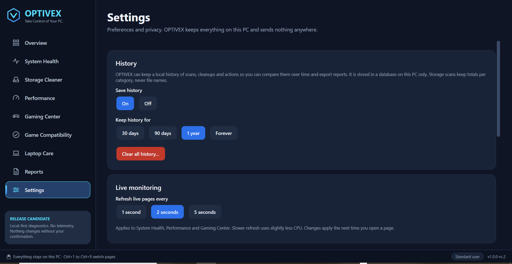

<div align="center">




<br>

<a href="https://github.com/rheillunio2-byte/OPTIVEX/stargazers"></a>
<a href="https://github.com/rheillunio2-byte/OPTIVEX/network/members"></a>
<a href="https://github.com/rheillunio2-byte/OPTIVEX/issues"></a>
<a href="https://github.com/rheillunio2-byte/OPTIVEX/pulls"></a>
<a href="https://github.com/rheillunio2-byte/OPTIVEX?tab=MIT-1-ov-file"></a>


<br><br>

<a href="#overview">Overview</a> &nbsp;·&nbsp;
<a href="#screenshots">Screenshots</a> &nbsp;·&nbsp;
<a href="#features">Features</a> &nbsp;·&nbsp;
<a href="#technology-stack">Stack</a> &nbsp;·&nbsp;
<a href="#installation-and-setup">Install</a> &nbsp;·&nbsp;
<a href="#safety-and-transparency">Safety</a> &nbsp;·&nbsp;
<a href="#roadmap">Roadmap</a> &nbsp;·&nbsp;
<a href="#contributing">Contribute</a>

</div>


## Overview

**OPTIVEX** is a Windows desktop application for understanding, maintaining and optimizing your PC. It brings live hardware monitoring, storage cleanup, startup and performance analysis, gaming tools, laptop battery care and a local history of what it found into one app.

Most PC "booster" tools make changes you cannot see, promise speed-ups nobody measured, and never explain why something was flagged. OPTIVEX is built the other way around:

- **It shows what it measured.** If a reading is not available on your hardware, it says *Unavailable* and gives the reason. It does not guess.
- **It explains before it acts.** Every recommendation states the issue, why it matters, the potential benefit, the risk, and whether you can undo it.
- **You stay in control.** Anything destructive shows a preview and asks first. Nothing is applied automatically.
- **It stays on your PC.** No telemetry, no accounts, no network calls.

**Who it is for:** everyday Windows users who want to know what is going on inside their PC, gamers checking whether a game fits their hardware, laptop owners watching battery wear, and developers or students who want a transparent example of a safe system utility.

<div align="center">



<sub><b>Overview</b>: a hardware snapshot, quick actions, and <i>Analyze my PC</i> recommendations based on your real readings.</sub>

</div>

> [!NOTE]
> **Project status: pre-release.** The source version is `1.0.0-rc.2` (release candidate). No packaged release has been published yet, so OPTIVEX is built from source for now. See [Installation and setup](#installation-and-setup). Behaviour that depends on specific hardware (sensors, batteries) can vary between PCs.


## Screenshots

<table>
  <tr>
    <td width="50%" valign="top">
      <br>
      <sub><b>System Health</b><br>Live CPU, memory, process, uptime and sensor readings. Unsupported sensors are labelled <i>Unavailable</i> with the reason.</sub>
    </td>
    <td width="50%" valign="top">
      <br>
      <sub><b>Storage Cleaner</b><br>A categorised scan of temporary files and caches. You pick files or categories and confirm a preview before anything is deleted.</sub>
    </td>
  </tr>
  <tr>
    <td width="50%" valign="top">
      <br>
      <sub><b>Performance</b><br>CPU and memory per program, a reversible startup manager, and power-plan and visual-effects advice.</sub>
    </td>
    <td width="50%" valign="top">
      <br>
      <sub><b>Gaming Center</b><br>Your gaming hardware, game profiles, a catalog of published requirements, and manual game entry.</sub>
    </td>
  </tr>
  <tr>
    <td width="50%" valign="top">
      <br>
      <sub><b>Game Compatibility</b><br>Compares RAM, free storage and Windows with a game's published requirements. CPU and GPU use your own assessment.</sub>
    </td>
    <td width="50%" valign="top">
      <br>
      <sub><b>Laptop Care</b><br>Battery health and capacity, cycle count when the battery reports it, the power plan, and temperatures where supported.</sub>
    </td>
  </tr>
  <tr>
    <td width="50%" valign="top">
      <br>
      <sub><b>Reports</b><br>A local history of scans and actions, comparison with the previous scan, and export to text, CSV or PDF.</sub>
    </td>
    <td width="50%" valign="top">
      <br>
      <sub><b>Settings</b><br>History and retention, live refresh speed, data and log folders, and privacy controls.</sub>
    </td>
  </tr>
</table>


## Features

<div align="center">



<sub>An illustration of the monitoring view. It contains no real data; real readings appear in the app.</sub>

</div>

### 1. System Health Monitor
Live CPU usage, memory, process count and uptime, plus CPU and GPU temperature and GPU load where the hardware exposes them. Two rolling charts show the last minute. OPTIVEX reports its own CPU use separately from total system CPU. Hardware details include CPU cores and logical processors, GPUs, motherboard, Windows build and architecture.

### 2. Smart Storage Cleaner
Scans an **allow-list** of folders: your temp folder, Chrome and Edge default-profile caches, shader and internet caches, and crash dumps. Files are grouped into categories and shown with size, date and location. Temp, log and dump files must be at least 24 hours old. Nothing is selected by default, a preview is shown before deletion, and deletions are permanent (they do not go to the Recycle Bin). A separate **large-file analyzer** lists big files for you to review and has no delete capability.

### 3. Performance Optimizer
Shows CPU and memory per program and labels Windows and security components. OPTIVEX **cannot end processes**. The startup manager lists registry and Startup-folder entries and can enable or disable them through the per-user `StartupApproved` switch (the mechanism Task Manager uses), which is reversible and deletes nothing. Power-plan and visual-effects guidance is advice only.

### 4. Gaming Performance Center
A dashboard with your CPU, GPU, RAM, free storage and live readings, plus hardware-specific notes. Game profiles can point at a game's program and show its CPU and memory while it runs. A searchable catalog lists published requirements with their source and verification date, and you can add games manually (labelled *User-provided*).

### 5. Game Compatibility Checker
Compares your PC with a game's published requirements and returns one of four results: *Meets Recommended*, *Meets Minimum*, *Below Minimum* or *Insufficient Information*. RAM, free storage and Windows are checked automatically. Processor and graphics models cannot be compared reliably by name, so you give your own assessment. OPTIVEX does not predict FPS. The bundled catalog is intentionally small (two entries, both read from official pages); add your own entries as needed.

### 6. Laptop Care
Battery charge and state, design versus full-charge capacity, a wear estimate when the figures are plausible, and cycle count when the battery reports it. It also shows the active power plan, temperatures, and a button that asks Windows to create its own battery report. On a desktop it says no battery was detected and the rest of the page still works.

### 7. Optimization Intelligence
**Analyze my PC** samples your system for a few seconds and produces rule-based recommendations. Each one contains the issue, an explanation, the potential benefit, the risk level, the recommended action, and whether it is reversible, and quotes the measured values it is based on. Anything that could not be read is listed under *Not assessed*. Recommendations are advice only and come with a button that opens the right page.

### 8. Reports and History
A local SQLite history of system scans, storage scans (category totals, not file names), cleanups, optimization actions and analyses. You can compare a scan with the previous one and export the history as text, CSV, or PDF through the Windows print dialog.

### 9. Settings and Configuration
Turn history on or off, choose how long it is kept, set the live refresh speed, open the data and log folders, and clear history. A dismissible welcome card appears on first run.


## Technology stack

Taken from the project files in `src/`.

| Area | Technology |
|---|---|
| Language and runtime | C# on .NET 8 |
| User interface | WPF, MVVM with `CommunityToolkit.Mvvm` 8.2.2 |
| Dependency injection | `Microsoft.Extensions.DependencyInjection` 8.0.1 |
| Hardware information | WMI through `System.Management` 8.0.0, Windows performance counters (`System.Diagnostics.PerformanceCounter` 8.0.0) |
| Sensors | `LibreHardwareMonitorLib` 0.9.3 |
| Charts | `LiveChartsCore.SkiaSharpView.WPF` 2.0.0-rc2 |
| Local storage | SQLite through `Microsoft.Data.Sqlite` 8.0.11; JSON for settings, profiles and your own games |
| Logging | Serilog 3.1.1 with `Serilog.Sinks.File` 5.0.0 |
| Tests | xUnit 2.6.6 |

## System requirements

| Requirement | Detail |
|---|---|
| Operating system | Windows. The Windows-specific projects target `net8.0-windows` and use WPF. OPTIVEX is intended for Windows 10 and Windows 11. *Verify the exact minimum Windows 10 build against Microsoft's .NET 8 supported-OS list.* |
| To build | [.NET 8 SDK](https://dotnet.microsoft.com/download/dotnet/8.0) |
| To run a published build | .NET 8 Desktop Runtime, unless published self-contained |
| Architecture | Not restricted in the project files. *Verify on 32-bit systems before relying on it.* |
| Permissions | Standard user is enough. CPU temperature may need administrator rights on some PCs. OPTIVEX never elevates itself. |

## Installation and setup

There is no packaged release yet, so OPTIVEX is built from source.

**1. Clone the repository**

```powershell
git clone https://github.com/rheillunio2-byte/OPTIVEX.git
cd OPTIVEX
```

**2. Restore dependencies** (needs internet for NuGet the first time)

```powershell
dotnet restore OPTIVEX.sln
```

**3. Build**

```powershell
dotnet build OPTIVEX.sln -c Release
```

**4. Run**

```powershell
dotnet run --project src/OPTIVEX.App/OPTIVEX.App.csproj -c Release
```

Or open `OPTIVEX.sln` in Visual Studio 2022, set **OPTIVEX.App** as the startup project and press **F5**.

**Run the tests** (optional)

```powershell
dotnet test tests/OPTIVEX.Tests/OPTIVEX.Tests.csproj
```

**Publish a folder you can copy** (optional)

```powershell
dotnet publish src/OPTIVEX.App/OPTIVEX.App.csproj -c Release -r win-x64 --self-contained false -o publish
```

The published build is not code-signed, so Windows SmartScreen may warn the first time you run it.

## Project structure

```text
OPTIVEX/
├── OPTIVEX.sln
├── Directory.Build.props            shared version and copyright
├── LICENSE
├── README.md
├── CONTRIBUTING.md
├── images/                          screenshots and README artwork (SVG)
├── src/
│   ├── OPTIVEX.Core/                models, interfaces and decision logic (net8.0)
│   ├── OPTIVEX.Data/                SQLite history and settings storage (net8.0)
│   ├── OPTIVEX.Infrastructure/      WMI, sensors, file system, battery (net8.0-windows)
│   └── OPTIVEX.App/                 WPF views, theme, view models, composition root (net8.0-windows)
└── tests/
    └── OPTIVEX.Tests/               xUnit tests for Core and Data
```

The layers are deliberate: anything that decides *what is safe* or *what to recommend* lives in `OPTIVEX.Core`, has no Windows dependency, and is unit-tested. The UI only presents it.


## Safety and transparency

OPTIVEX is designed so that a bug or a misclick cannot damage your files or your system.

- **Understand before you act.** Recommendations explain the issue, the benefit, the risk and whether the action is reversible.
- **Confirmation for anything destructive.** Deleting files shows a preview and asks first. The default answer is *No*.
- **Personal files are never touched.** Cleanup only looks at an allow-list of temp and cache locations. Downloads, Documents, Pictures, Videos, projects and Windows folders are never scanned.
- **Strict path safety.** Directory-boundary checks, drive roots refused, symbolic links and junctions never followed, and every file is re-validated at the moment of deletion.
- **No process killing, no service changes, no registry cleaning.** The only change OPTIVEX can make to Windows is the reversible per-user startup switch, and it refuses Windows Security and Defender entries.
- **No unsupported promises.** OPTIVEX does not claim speed-ups, FPS figures or sensor values it did not measure. Unavailable readings are labelled as such.
- **Local only.** Data stays in `%LOCALAPPDATA%\OPTIVEX` (history database, settings, profiles, logs). Nothing is sent over the network, and you can turn history off or delete the folder at any time.

## Roadmap

Implemented in the current source: the nine modules described above.

Planned or under consideration (none of these are done):

- [ ] Confirm behaviour across more hardware: different laptops, desktops, GPU vendors and batteries
- [ ] A larger game catalog, using official sources only
- [ ] Historical trend charts in Reports
- [ ] A packaged release with an installer and code signing
- [ ] An accessibility review (screen readers, high contrast, display scaling)
- [ ] Localization
- [ ] Automated UI tests
- [ ] Automatic CPU and GPU comparison, only if trustworthy benchmark data becomes available

Ideas and priorities are welcome through [issues](https://github.com/rheillunio2-byte/OPTIVEX/issues).

## Contributing

Contributions of all sizes are welcome: bug reports, documentation, tests and code. Please read [CONTRIBUTING.md](CONTRIBUTING.md) first. It covers setup, branch and commit conventions, coding standards and the safety rules every change must respect.

## License

OPTIVEX is released under the **[MIT License](https://github.com/rheillunio2-byte/OPTIVEX?tab=MIT-1-ov-file)**.


<div align="center">


<sub>Built to make a PC understandable, not mysterious. Maintained by <a href="https://github.com/rheillunio2-byte">@rheillunio2-byte</a>.</sub>

</div>
